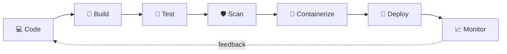

 

---

## 👋 About Me

I'm a **DevOps Engineer in the making** with a software-development background. I focus on **cloud automation**: pipelines that build, test, scan and ship code, AWS tooling that finds waste and misconfigurations, and Kubernetes setups that heal themselves.

I'm currently going through the **CloudDevOpsHub Multi Cloud + DevOps with AI Challenge (Batch-45)** and turn every topic into a hands-on repo, so what you see below is practised work, not just a list of tools.

- ⚙️ Building: CI/CD pipelines, AWS cost & security automation, Kubernetes self-healing demos
- 🔐 Interested in: DevSecOps and AI-assisted automation
- 🌱 Learning: Jenkins → Docker → Kubernetes → Terraform → Ansible → Azure
- 📍 Based in Pune, India

---

## 🔁 My DevOps Workflow

| Stage | What I practise | Where to see it |
|---|---|---|
| 💻 **Code** | Git/GitHub, branching, PR checks | [MultiCloud-DevOps-AI-Challenge](https://github.com/shubhamkhedkar/MultiCloud-DevOps-AI-Challenge) |
| 🔨 **Build** | Maven / npm / pip builds in GitHub Actions | [weather-forecast-app](https://github.com/shubhamkhedkar/weather-forecast-app), [cicd-pipeline-python-nodejs](https://github.com/shubhamkhedkar/cicd-pipeline-python-nodejs) |
| 🧪 **Test** | Matrix tests, linting, coverage | [cicd-pipeline-python-nodejs](https://github.com/shubhamkhedkar/cicd-pipeline-python-nodejs) |
| 🛡️ **Scan** | CodeQL, Trivy, OWASP Dependency-Check, SAST, OSV | [weather-forecast-app](https://github.com/shubhamkhedkar/weather-forecast-app), [vuln-code-scanner](https://github.com/shubhamkhedkar/vuln-code-scanner) |
| 🐳 **Containerize** | Multi-stage Dockerfiles, non-root images, GHCR | [weather-forecast-app](https://github.com/shubhamkhedkar/weather-forecast-app) |
| 🚀 **Deploy** | Kubernetes manifests, Kustomize, Helm | [k8s-self-healing](https://github.com/shubhamkhedkar/k8s-self-healing) |
| 📈 **Monitor** | Health checks, probes, HPA autoscaling | [k8s-self-healing](https://github.com/shubhamkhedkar/k8s-self-healing) |

---

## 🧭 DevOps Capability Areas

| Area | What I've done | Status |
|---|---|---|
| 🔄 **CI/CD** | GitHub Actions pipelines: path filters, matrix builds, lint, tests, coverage, Docker build and push to GHCR, release workflow. Jenkins is next in the course. | ✅ Hands-on · 🔄 Jenkins learning |
| 🐳 **Containers & Orchestration** | Dockerised apps with health checks. Kubernetes probes, replicas, PodDisruptionBudget, HPA, Kustomize and a Helm chart. | ✅ Hands-on · 🔄 Docker & K8s deep-dive in course |
| ☁️ **Cloud (AWS)** | Completed the AWS module. Built read-only boto3 tools for cost optimisation and security auditing (EC2, EBS, S3, IAM, RDS, Lambda, CloudTrail…). | ✅ Hands-on · ⏳ Azure planned |
| 🏗️ **Infrastructure as Code** | Wrote Terraform scanning rules for IaC checks. Writing and applying Terraform is the next course module. | 🔄 Learning (Terraform, Ansible) |
| 📈 **Monitoring & Observability** | Health endpoints (Spring Boot Actuator), liveness/readiness probes, CloudWatch metrics for cost analysis. A full metrics and dashboard stack is on my exploration list. | 🌱 Foundations |
| 🛡️ **DevSecOps** | SAST CLI with SARIF output, secret detection, dependency scanning (OSV), CodeQL, Trivy, OWASP Dependency-Check, Dependabot, AI-assisted triage. | ✅ Hands-on |
| 🐍 **Scripting & Automation** | Python CLIs, Bash scripts (cluster setup, failure simulator), Git workflows. | ✅ Hands-on |

---

## 🧰 Tech Stack

**☁️ Cloud**

**🔄 CI/CD & Source Control**

**🐳 Containers & Orchestration**

**🏗️ Infrastructure as Code & Config Management**

**🛡️ DevSecOps**

**🐧 Scripting & Languages**

---

## 🚀 Featured DevOps Projects

### 🔄 CI/CD & Containers

| Project | What it does | Stack |
|---|---|---|
| [**cicd-pipeline-python-nodejs**](https://github.com/shubhamkhedkar/cicd-pipeline-python-nodejs) | Path-filtered CI/CD for a Python and a Node.js API: matrix tests across runtime versions, linting, coverage, Docker builds, and publishing to GHCR on `main`. | `GitHub Actions` `Docker` `GHCR` `pytest` `Jest` |
| [**ai-powered-cicd-pipeline**](https://github.com/shubhamkhedkar/ai-powered-cicd-pipeline) | GitHub Actions pipeline with AI code review, PR risk-score labels, CI failure analysis and AI-written release notes. It works with any OpenAI-compatible API and skips AI steps cleanly without a key. | `GitHub Actions` `Python` `Docker` `LLM` |
| [**weather-forecast-app**](https://github.com/shubhamkhedkar/weather-forecast-app) | A Spring Boot app used as a **delivery pipeline showcase**: CI, CD and release workflows, CodeQL, Trivy and OWASP Dependency-Check scans, Dependabot, a multi-stage non-root Docker image with `HEALTHCHECK`, and GHCR publishing. | `GitHub Actions` `Docker` `Maven` `Trivy` `CodeQL` |

### ☸️ Kubernetes & Cloud

| Project | What it does | Stack |
|---|---|---|
| [**k8s-self-healing**](https://github.com/shubhamkhedkar/k8s-self-healing) | Shows how Kubernetes keeps apps alive: startup/liveness/readiness probes, auto-restarts, replicas, PodDisruptionBudget, HPA autoscaling and a failure simulator. Runs on kind or minikube. | `Kubernetes` `Kustomize` `Helm` `Bash` |
| [**aws-cost-advisor**](https://github.com/shubhamkhedkar/aws-cost-advisor) | Read-only CLI that scans an AWS account for wasteful resources (idle EC2, unattached EBS, NAT, RDS, S3, Lambda), estimates monthly savings and optionally asks an LLM for prioritised fixes. It ships a least-privilege IAM policy. | `AWS` `Python` `boto3` `CloudWatch` `IAM` |

### 🛡️ AI-powered DevSecOps

| Project | What it does | Stack |
|---|---|---|
| [**ai-powered-cloud-security-engine**](https://github.com/shubhamkhedkar/ai-powered-cloud-security-engine) | Read-only AWS misconfiguration scanner (S3, IAM, EC2/SG, RDS, KMS, CloudTrail, GuardDuty) mapped to CIS and AWS FSBP, plus Terraform IaC checks. AI explains and prioritises fixes, with secrets redacted first. | `AWS` `Terraform` `Python` `FastAPI` `LLM` |
| [**vuln-code-scanner**](https://github.com/shubhamkhedkar/vuln-code-scanner) | `vulnscan`, a SAST CLI for dangerous code, hardcoded secrets and insecure Dockerfile/Kubernetes/Actions config. It checks dependencies against OSV.dev and reports as table, JSON, **SARIF** (GitHub code scanning) or HTML. | `Python` `SARIF` `OSV` `Docker` `pre-commit` |

### 🧩 Other projects

[✂️ **cutout**](https://github.com/shubhamkhedkar/cutout) (in-browser AI background remover · [live](https://shubhamkhedkar.github.io/cutout/)) · [🍅 **pomo**](https://github.com/shubhamkhedkar/pomo) (Pomodoro timer · [live](https://shubhamkhedkar.github.io/pomo/)) · [🌐 **portfolio**](https://github.com/shubhamkhedkar/portfolio) ([live](http://nomadshubham.s3-website.ap-south-1.amazonaws.com))

---

## 📚 Currently Learning

Following the **[Multi Cloud + DevOps with AI Challenge (Batch-45)](https://github.com/shubhamkhedkar/MultiCloud-DevOps-AI-Challenge)** by CloudDevOpsHub. My daily notes live in my fork of the course repo.

| Stage | Topic | Status |
|:---:|---|:---:|
| 1 | ☁️ **AWS** | ✅ Completed |
| 2 | 🔀 **Git & GitHub** | ✅ Completed |
| 3 | 🏗️ **Jenkins** (CI/CD) | 🔄 In progress |
| 4 | 🐳 **Docker** | ⏳ Up next |
| 5 | ☸️ **Kubernetes** | ⏳ Up next |
| 6 | 🌍 **Terraform** | ⏳ Planned |
| 7 | 🔧 **Ansible** | ⏳ Planned |
| 8 | 🔷 **Azure** (multi-cloud) | ⏳ Planned |

---

## 📊 GitHub Stats

 

---

### 🤝 Let's connect

*Automate everything. Learn in public.* 🚀

